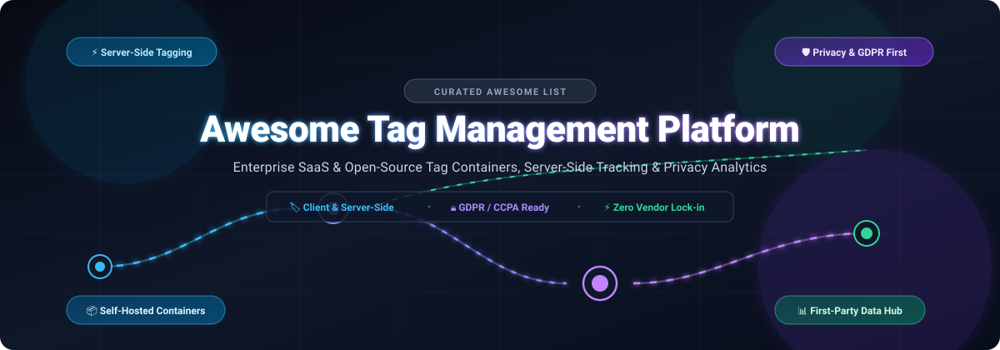

<div align="center">



# 🏷️ Awesome Tag Management Platform

<p align="center">
  <strong>A curated directory of enterprise SaaS platforms, open-source tag management systems, server-side tracking containers, and privacy-compliant event orchestration tools.</strong>
</p>

<p align="center">
  <a href="https://github.com/ishandutta2007/Awesome-Awesome-Awesome"></a><a href="https://discord.gg/jc4xtF58Ve"></a>
  <a href="https://github.com/ishandutta2007/Awesome-Tag-Management-Platform/stargazers"></a>
  <a href="https://github.com/ishandutta2007/Awesome-Tag-Management-Platform/network/members"></a>
  <a href="LICENSE"></a>
  <a href="https://github.com/ishandutta2007/Awesome-Tag-Management-Platform/pulls"></a>
  <a href="https://github.com/ishandutta2007"></a>
</p>

</div>

---

## 🔍 SEO Overview & Keywords

> **Target Keywords:** Tag Management Systems (TMS), Server-Side Tagging (SST), Google Tag Manager Alternatives, Client-Side Tag Injection, Customer Data Infrastructure (CDI), First-Party Data Pipeline, Web Analytics, Consent Management Platforms (CMP), GDPR & CCPA Compliance, Event Routing, Tag Container Security.

A **Tag Management Platform (TMP)** empowers engineering and digital marketing teams to deploy, orchestrate, and audit third-party tracking pixels, analytics scripts, and conversion tags across web and mobile applications without redeploying code. As third-party cookie depreciation and global privacy mandates (GDPR, CCPA, ePrivacy) accelerate, modern tag management has rapidly evolved from simple browser JavaScript injection into high-performance **server-side tag gateways**, edge proxy containers, and privacy-preserving customer data pipelines.

---

## 📑 Table of Contents

- [📊 Sector Overview & Market Dynamics](#-sector-overview--market-dynamics)
- [💼 Enterprise SaaS & Commercial Tag Management Platforms](#-enterprise-saas--commercial-tag-management-platforms)
- [💻 Open-Source Tag Management & Event Routing Engines](#-open-source-tag-management--event-routing-engines)
- [🛡️ Architecture & Deployment Paradigms](#️-architecture--deployment-paradigms)
- [🤝 How to Contribute](#-how-to-contribute)
- [⭐ Star History](#-star-history)
- [☕ Support & Sponsorship](#-support--sponsorship)
- [⚖️ Disclaimer & Security Best Practices](#️-disclaimer--security-best-practices)

---

## 📊 Sector Overview & Market Dynamics

The global **Tag Management Software (TMS) market** is valued at approximately **$1.8 Billion** in 2024 and is projected to expand to **$3.6 Billion by 2030**, advancing at a Compound Annual Growth Rate (**CAGR**) of **12.5%**. 

From a competitive concentration perspective, the sector exhibits a **winner-take-most dynamic in the standard client-side segment**, where Google Tag Manager (GTM) controls an overwhelming **85% to 90% market share** owing to its deep integration into the Google Marketing Platform ecosystem and zero-barrier free web tier. Conversely, the **enterprise governance, server-side tagging, and privacy-first data routing tier is moderately fragmented**: enterprise leaders such as Adobe Experience Platform Launch and Tealium iQ compete aggressively on vendor neutrality, multi-cloud data orchestration, and granular auditability, while innovative server-side hosting infrastructures (e.g., Stape) and open-source customer data platforms (e.g., Snowplow, Jitsu, RudderStack) capture rapidly growing demand for first-party data ownership and ad-blocker resilience.

---

## 💼 Enterprise SaaS & Commercial Tag Management Platforms

The following table summarizes the prominent commercial and SaaS tag management platforms. Products are sorted in **descending order by company scale** (annual revenue or enterprise valuation).

| 🏢 Platform | 📈 Company Scale (Revenue / Valuation) | 🎯 Core Capabilities & Architecture | 💳 Pricing (Starting Paid Tier) | 🎁 Free Tier Limits / Free Trial Details |
| :--- | :--- | :--- | :--- | :--- |
| **[Google Tag Manager](https://tagmanager.google.com/)** | **Alphabet Inc.: ~$307.4B Revenue / ~$2.1T Market Cap** | Universal web & mobile tag container ecosystem; native triggers, variables, built-in templates, and server-side container orchestration via GCP Cloud Run / Docker. | **$0/month** for standard web containers; **GTM 360** starts at **$50,000/year** (or bundled with Google Analytics 360 at **~$150,000/year**); Server-side GCP compute costs approx. **$30 to $120/month**. | **Free forever** for standard web containers (up to 200 KB container size limit, unlimited tags, triggers, and accounts); Server-side setup includes Google Cloud Free Tier (**$300 credit for 90 days** + **2M free Cloud Run requests/month** forever). |
| **[Adobe Experience Platform Launch](https://experienceleague.adobe.com/en/docs/experience-platform/tags/home)** | **Adobe Inc.: ~$21.4B Revenue / ~$220B Market Cap** | Enterprise rule-based client and server tag delivery engine deeply integrated with Adobe Experience Cloud, Real-Time CDP, and Customer Journey Analytics. | Included within Adobe Experience Cloud subscriptions, with entry enterprise bundles starting at **$2,000/month** (**$24,000/year minimum contract**). | **30-day proof-of-concept enterprise sandbox trial** (up to 5 staging properties, 100,000 server calls, guided technical onboarding); complimentary developer sandbox access via Adobe Solution Partner Program. |
| **[Twilio Segment](https://segment.com/)** | **Twilio Inc.: ~$4.15B Revenue / ~$11.2B Market Cap** | Category-defining Customer Data Platform (CDP) and event collection pipeline; unifies web, mobile, and server events to route across 450+ downstream analytics and ad destinations. | **Team Tier** starts at **$120/month** (billed annually at **$1,440/year**) covering up to 10,000 Monthly Tracked Users (MTUs) and 3 sources; Business Tier custom quoted by event volume. | **Free forever plan** includes up to **1,000 Monthly Tracked Users (MTUs)**, **2 web/mobile sources**, unlimited destinations, and 300+ out-of-the-box pre-built connectors. |
| **[Tealium iQ](https://tealium.com/products/tealium-iq-tag-management-system/)** | **Tealium Inc.: ~$1.2B Valuation / ~$150M ARR** | Enterprise vendor-neutral tag management platform featuring 1,300+ turnkey extensions, privacy consent governance, and real-time EventStream server-side delivery. | Starts at **$12,000/year** (**$1,000/month**) for standalone enterprise tag management; EventStream API & CDP modules start at **$25,000/year**. | **30-day enterprise sandbox trial** with dedicated technical account manager, up to 100,000 test events, and complete access to the turnkey vendor marketplace. |
| **[Piwik PRO Tag Manager](https://piwik.pro/tag-manager/)** | **Piwik PRO: ~$20M ARR (Bootstrapped Enterprise)** | Privacy-first analytics and tag management suite; features synchronous/asynchronous tag triggers, built-in Consent Manager, and on-premises or EU/US sovereign cloud hosting. | **Core Plan** is **$0/month forever**; Enterprise tier starts at **$11,000/year** (**~$917/month**) providing custom SLAs, raw event exports, and dedicated cloud/on-prem environments. | **Free forever Core plan** includes up to **500,000 actions/events per month**, unlimited tags and containers, built-in Consent Manager, and **14-month data retention**. |
| **[Commanders Act](https://www.commandersact.com/en/solutions/tag-commander/)** | **Commanders Act: ~$15M ARR (European Market Leader)** | European tag and consent orchestrator (TagCommander); engineered for strict GDPR/CNIL compliance, cookieless server-side tracking, and multi-touch attribution. | **Tag Commander** module starts at **€800/month** (**~$870/month**) for up to 1,000,000 monthly hits; complete Omnichannel suite starts at **€1,500/month**. | **14-day full-access free trial** supporting up to 50,000 events, pre-configured sandbox containers, and full access to 800+ pre-built vendor tag templates. |
| **[Stape.io](https://stape.io/)** | **Stape Inc.: ~$8M ARR (Specialized SST Infrastructure)** | Managed cloud infrastructure, custom domain masking, and power-up plugins built specifically for hosting and optimizing Google Tag Manager server-side containers. | **Pro Tier** starts at **$20/month** for up to 500,000 requests/month; **Business Tier** starts at **$100/month** for up to 3,000,000 requests/month. | **Free forever plan** includes **1 server-side container**, up to **10,000 requests/month**, custom domain support, and access to open-source SST templates. |

---

## 💻 Open-Source Tag Management & Event Routing Engines

Below is a comprehensive collection of active open-source tag containers, server-side data collection hubs, and GTM developer utilities. Repositories are sorted in **descending order by GitHub Stars_Count**.

1. **[Snowplow](https://github.com/snowplow/snowplow)** [](https://github.com/snowplow/snowplow/stargazers) — **The enterprise leader in customer data infrastructure & behavioral event pipelines.** Provides high-throughput server-side event collectors, real-time validation against JSON schemas, and deterministic streaming directly to data warehouses and marketing destinations without third-party vendor leakage.
2. **[Jitsu](https://github.com/jitsucom/jitsu)** [](https://github.com/jitsucom/jitsu/stargazers) — **Fully scriptable open-source data ingestion engine and tag/event delivery platform.** Serves as a modern open-source alternative to Segment and server-side GTM; captures client-side and server-side events, transforms them via JavaScript routines in real-time, and dispatches them to hundreds of analytics, CRM, and ad storage endpoints.
3. **[RudderStack (Rudder Server)](https://github.com/rudderlabs/rudder-server)** [](https://github.com/rudderlabs/rudder-server/stargazers) — **Enterprise-grade open-source customer data platform and tag-routing backend.** Built in Go and React, it collects clickstream events from web, mobile, and server SDKs, orchestrates user transformations, and routes payloads securely to downstream analytics, marketing pixels, and data warehouses.
4. **[React GTM](https://github.com/alinemorelli/react-gtm)** [](https://github.com/alinemorelli/react-gtm/stargazers) — **Lightweight, battle-tested React library for Google Tag Manager integration.** Handles automatic snippet injection, virtual pageviews on client-side route transitions, and stateful `dataLayer` management in Single-Page Applications (SPAs).
5. **[walkerOS (elbwalker)](https://github.com/elbwalker/walkerOS)** [](https://github.com/elbwalker/walkerOS/stargazers) — **Modern open-source event-driven tag manager, consent orchestrator, and tracking layer.** Designed specifically for developers, privacy engineers, and autonomous AI agents; supports fine-grained consent states, zero external dependencies, and modular destination triggers.
6. **[Nuxt GTM Module](https://github.com/nuxt-community/gtm-module)** [](https://github.com/nuxt-community/gtm-module/stargazers) — **Official community Google Tag Manager integration for Nuxt.js.** Implements automatic page-tracking, route change listening, server-side rendering (SSR) safety checks, and non-blocking asynchronous script injection.
7. **[Scale8 Tag Manager & Analytics](https://github.com/scale8/scale8-tag-manager-and-analytics)** [](https://github.com/scale8/scale8-tag-manager-and-analytics/stargazers) — **Self-hosted, privacy-first web analytics and tag management engine.** Compliant with GDPR and CCPA out of the box; supports tracking pixel generation, custom event endpoints, and client JavaScript error tracking without cookie tracking.
8. **[Save Analytics From Content Blockers](https://github.com/dataunlocker/save-analytics-from-content-blockers)** [](https://github.com/dataunlocker/save-analytics-from-content-blockers/stargazers) — **Open-source reverse proxy and tag delivery gateway.** Securely proxies Google Tag Manager and Google Analytics network requests through your first-party domain, restoring tracking fidelity lost to client-side ad and tracker blockers.
9. **[Matomo Tag Manager](https://github.com/matomo-org/tag-manager)** [](https://github.com/matomo-org/tag-manager/stargazers) — **The premier self-hosted open-source tag management system (GPL-3.0).** Provides a complete visual interface for configuring tags, triggers, and variables directly within your self-hosted Matomo installation, offering a 100% data-sovereign alternative to Google Tag Manager.
10. **[React Google Tag Manager](https://github.com/holidaycheck/react-google-tag-manager)** [](https://github.com/holidaycheck/react-google-tag-manager/stargazers) — **HolidayCheck's React-based implementation for GTM container snippets.** Delivers deterministic container initialization, server-side rendering compatibility, and type-safe dataLayer dispatching in React apps.
11. **[GTM DataLayer Test](https://github.com/sahava/gtm-datalayer-test)** [](https://github.com/sahava/gtm-datalayer-test/stargazers) — **Automated functional testing suite and validator for GTM `dataLayer` events.** Enables CI/CD pipeline verification of tracking event payloads and schemas before tag containers are deployed to production.
12. **[GTM CLI](https://github.com/owntag/gtm-cli)** [](https://github.com/owntag/gtm-cli/stargazers) — **Developer command-line interface for the Google Tag Manager API.** Empowers DevOps and analytics engineering teams to automate container backups, run schema diffs, version tag configurations, and synchronize environments programmatically.
13. **[TagPiper](https://github.com/analytics-debugger/tagpiper)** [](https://github.com/analytics-debugger/tagpiper/stargazers) — **Ultra-lightweight open-source server-side tag management engine.** Created by David Vallejo as a lean alternative to Google Server GTM; packages a Go + QuickJS backend and Nuxt UI into a tiny 12 MB Docker container sustaining 2,500+ requests/sec without GCP dependencies.
14. **[SilverStripe Tag Manager](https://github.com/sminnee/silverstripe-tagmanager)** [](https://github.com/sminnee/silverstripe-tagmanager/stargazers) — **Server-side tag management module for the SilverStripe CMS ecosystem.** Injects and orchestrates marketing tags on the server tier before page rendering, eliminating client-side render-blocking scripts.
15. **[Pimcore Google Marketing Bundle](https://github.com/pimcore/google-marketing-bundle)** [](https://github.com/pimcore/google-marketing-bundle/stargazers) — **Community marketing bundle for Pimcore and OpenDXP.** Enables dynamic Google Tag Manager container injection, Search Console verification, and contextual e-commerce dataLayer event dispatching.
16. **[Sesamy CLI & SDK](https://github.com/foomo/sesamy-cli)** [](https://github.com/foomo/sesamy-cli/stargazers) — **Server-side tag management framework written in Go.** Generates type-safe code to synchronize backend event schemas with frontend tags and GTM containers across full-stack applications.

---

## 🛡️ Architecture & Deployment Paradigms

```
┌─────────────────────────────────────────────────────────────┐
│                      Client Browser                         │
│  ┌───────────────────────┐       ┌───────────────────────┐  │
│  │  Client-Side Tags     │       │   Consent Orchestrator│  │
│  │ (Matomo / React-GTM)  │       │      (walkerOS)       │  │
│  └───────────┬───────────┘       └───────────┬───────────┘  │
└──────────────┼───────────────────────────────┼──────────────┘
               │ First-Party Event Stream      │
               ▼                               ▼
┌─────────────────────────────────────────────────────────────┐
│             First-Party Server-Side Gateway                 │
│  ┌───────────────────────────────────────────────────────┐  │
│  │   Server Container (TagPiper / Stape / Jitsu / SGTM)  │  │
│  │   • PII Anonymization & IP Masking                    │  │
│  │   • Cookie & Header Normalization                     │  │
│  │   • Real-Time Schema Validation (Snowplow / Rudder)   │  │
│  └───────────────────────────┬───────────────────────────┘  │
└──────────────────────────────┼──────────────────────────────┘
                               │ Cleaned Server Payloads
         ┌─────────────────────┼─────────────────────┐
         ▼                     ▼                     ▼
┌─────────────────┐   ┌─────────────────┐   ┌─────────────────┐
│ Google Analytics│   │ Meta Conversions│   │ Cloud Warehouse │
│      (GA4)      │   │    API (CAPI)   │   │(BigQuery/Snowfl)│
└─────────────────┘   └─────────────────┘   └─────────────────┘
```

### ⚡ Client-Side vs. Server-Side Tagging Comparison

| Dimension | 🌐 Client-Side Tagging (Standard) | ⚡ Server-Side Tagging (SST) |
| :--- | :--- | :--- |
| **Execution Point** | User's browser / mobile device | First-party server / edge container |
| **Site Performance** | Can degrade PageSpeed / Core Web Vitals | Zero client-side bloat; consolidated single payload |
| **Ad-Blocker Impact** | Frequently blocked (15% to 35% data loss) | Immune when served through a first-party subdomain |
| **Data Privacy (GDPR)** | Third-party scripts access device storage & cookies | Server strips PII, hashes IPs, and controls data flow |
| **Infrastructure Cost** | Typically free or SaaS bundled | Requires container hosting compute (e.g., Cloud Run, Docker) |

---

## 🤝 How to Contribute

We welcome contributions from marketers, developers, and privacy engineers! To add or update an entry:

1. 🍴 **Fork the repository** on GitHub.
2. 🌿 **Create a new branch** (`git checkout -b feature/add-new-tag-manager`).
3. 📝 **Add or update entries** in `README.md` maintaining table and markdown consistency:
   - Provide the project name, official URL, and exact GitHub Stars_Count badge for open-source entries.
   - For SaaS products, include exact company scale, specific starting tier pricing, and explicit free tier or trial limits.
4. 🚀 **Commit your changes** (`git commit -m "Add New Tag Management Project"`).
5. 📬 **Submit a Pull Request** with a concise description of why the tool qualifies.

---

## ⭐ Star History

[](https://star-history.dera.page/#ishandutta2007/Awesome-Tag-Management-Platform&type=date&legend=top-left)

---

## ☕ Support & Sponsorship

If this curated repository saved you time, helped you evaluate tag management architecture, or optimized your data pipeline, please consider supporting the project:

- ⭐ **Star this repository** to help others discover it on GitHub.
- 🍴 **Fork and contribute** to keep the listings fresh and comprehensive.
- 📢 **Share this resource** with your engineering and analytics teams on Twitter, LinkedIn, and developer communities.
- ☕ **Buy me a coffee & become a sponsor** to fuel ongoing open-source curation:

<p align="center">
  <a href="https://github.com/sponsors/ishandutta2007">
    
  </a>
</p>

Thank you to all community contributors and sponsors for empowering open, transparent, and privacy-respecting analytics infrastructure! 🙌

---

## ⚖️ Disclaimer & Security Best Practices

- This list is a **community-curated directory** provided for educational and architectural evaluation purposes; inclusion does not constitute commercial endorsement.
- **Security Warning:** Tag management platforms possess the authority to dynamically execute JavaScript and route event payloads across user sessions. Always enforce **Content Security Policies (CSP)**, **Subresource Integrity (SRI)**, strict container access controls, multi-factor authentication (MFA), and audit logging before running tags in production environments.
